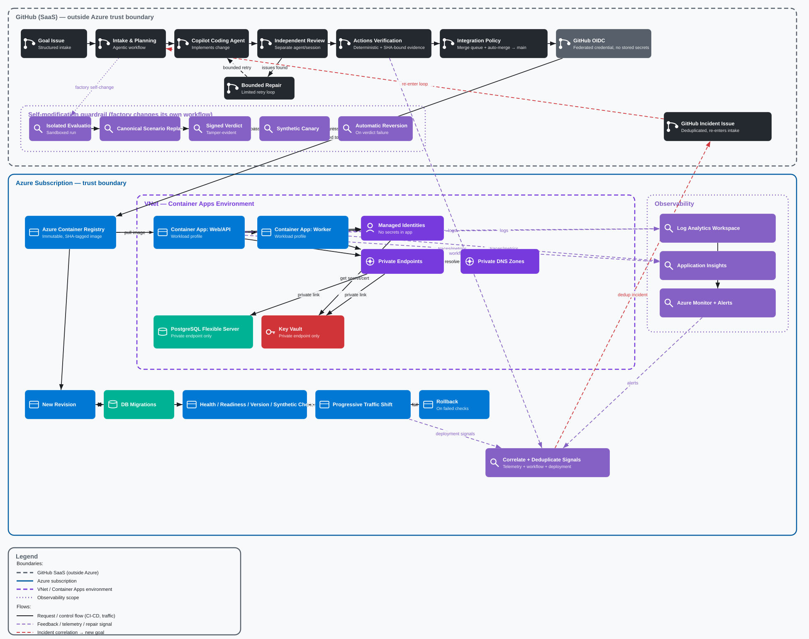

```text
                 ___       ___       ___
                |:::|     |:::|     |:::|
                |:::|_____|:::|_____|:::|
          ______|_______________________|______
         /  DARK FACTORY  //  CONTROL ROOM     /|
        /____________________________________/ |
        |  [GOAL] --> [BUILD] --> [VERIFY]    | |
        |                            |        | |
        |  [LEARN] <-- [OBSERVE] <-- [SHIP]   | /
        |____________________________________|/
           Governed automation. Visible evidence.
```

# Dark Factory Control Room

**Explore governed autonomous software delivery: from a structured request
through verification and independent review to delivery and recovery.**

For platform engineering leads, developers, SREs, security leads, and SEs/CSAs.
Reusable across industries; no customer account is implied.

## Customer story

Platform teams want AI-assisted delivery without losing quality or control.
Requests, reviews, releases, and incident evidence are often scattered across
tools, making handoffs slow and decisions difficult to trace. Dark Factory
demonstrates explicit authorization, bounded execution, independent review,
and recovery evidence. Its local simulations help teams explore the pattern
without connecting to production.

## Choose your experience

| Experience                 | What you get                                                        | Boundary                                             |
| -------------------------- | ------------------------------------------------------------------- | ---------------------------------------------------- |
| Control-room preview       | Service posture, synthetic metrics, goals, incidents, audit lineage | Not live GitHub/Azure operational telemetry          |
| Offline scenarios          | Repeatable success, repair, rejection, rollback, exhaustion         | No real PRs, deployments, or dashboard updates       |
| Configured live automation | GitHub/Azure workflow and infrastructure patterns                   | Requires explicit setup; not activated by quickstart |

**Readiness: demo candidate, not catalog-ready or Microsoft certified.**
Production telemetry requires a `FactoryOperationsAdapter`; unconfigured
production mode fails closed. Sample metrics and costs are illustrative.
See [readiness gates and evidence](docs/operations-runbook.md#accelerator-readiness).

## Start locally

Requires Node.js 22 and npm 10 or newer. From the repository root:

```sh
npm run bootstrap -- --apply
npm run config:validate
npm run demo:offline
npm run dev:api
```

Open **http://localhost:3000**. Bootstrap preserves an existing `.env`, installs
locked dependencies, and builds. Initial installation needs network access;
the scenarios then run without credentials or GitHub/Azure calls.
Environment overrides must be exported in your shell; copying `.env` alone
does not load it into the API process.

## Demonstrate and adapt

Follow the [five- and fifteen-minute scripts](docs/operations-runbook.md#presenter-guide)
and [setup, reset, and troubleshooting guide](docs/operations-runbook.md).
The presenter guide includes customer discovery, pilot measures, reuse boundaries,
and publication blockers.



**Goal → policy/budget checks → implementation → verification → independent
review → progressive delivery → observation/recovery → next bounded goal.**
See the [architecture and trust boundaries](docs/architecture.md).

Live activation is separate: read the [operations runbook](docs/operations-runbook.md)
and [infrastructure guide](infra/README.md). Azure resources and agent execution
can incur charges. Teardown tooling emits a plan, not deletion.

## Support, contribution, and licensing

Use repository issues for **sanitized, non-sensitive** reproducibility questions;
no response SLA or dedicated support owner is established. Never post credentials
or vulnerability details publicly: use GitHub private vulnerability reporting
only if enabled, otherwise obtain a private maintainer contact first.
No license grant has been established; owner-approved licensing and attribution
remain prerequisites for redistribution and catalog submission.

Adapt one reversible non-production workflow first. Preserve policy, independent
review, tests, least privilege, and recovery boundaries. Review
[`accelerator.yaml`](accelerator.yaml) as a **metadata draft**, not a validated
catalog submission.

**Next step:** bring one low-risk change request, its repository owner, and an
operations/security representative to define a measurable pilot.

## Engineering reference

Production-oriented Node.js 22 monorepo for an autonomous operations control
room. It contains:

- `apps/web`: React and Vite control room.
- `apps/api`: Fastify API, policy evaluation, and operational endpoints.
- `apps/worker`: observable background polling process.
- `packages/contracts`: shared TypeScript API contracts.
- `packages/policy-engine`: deterministic, deny-by-default policy evaluation.
- `packages/observability`: structured logging and tracing helpers.

## Development

Requires Node.js 22 and npm 10 or newer.

```sh
npm ci
npm run dev:api
npm run dev:web
```

Run `npm run dev:worker` separately when worker behavior is needed. Copy
`.env.example` to `.env` to customize local settings; the example contains no
credentials.

## Quality gates

```sh
npm run verify
```

The deterministic verifier runs formatting, linting, type checking, unit and
API contract tests, coverage thresholds, browser accessibility checks, build,
dependency and secret scans, container and IaC policy checks, the locally
installed Bicep compiler, mutation testing, and workflow validation. It writes
the policy-gated, hash-addressed evidence manifest to
`.evidence/manifest.json`. Bicep validation never downloads or installs tools;
set `BICEP_PATH` when the compiler is installed outside the standard Azure CLI
location.

GitHub Actions additionally runs CodeQL, dependency review, Trivy filesystem,
IaC, secret, and built-container scans. All external actions are commit-pinned.
Agentic workflow Markdown sources and generated lock workflows are kept in sync
by `gh aw compile`; generated maintenance output is deterministically hardened
with concurrency and timeout bounds before the synchronization diff is checked.
Copilot inference is billed to the organization through
`copilot-requests: write`. Lifecycle safe-output jobs mint short-lived,
repository-scoped installation tokens for the Dark Factory Mage GitHub App;
the App private key is never provided to the reasoning job. Goal implementation
uses the App-authenticated `create-pull-request` code-writing boundary, and
bounded repair uses `push-to-pull-request-branch` against the single reconciled
pull request. No user PAT or `assign-to-agent` handoff is used.

The API exposes `GET /healthz`, `GET /readyz`, `GET /version`, and
`POST /api/policies/evaluate`. `GET /api/factory/overview` powers the control
room's delivery metrics, active goals/incidents, deployments, and audit ledger.
Policy rules are ordered by descending priority
and then stable rule ID, so identical inputs always produce identical results.
Every autonomous decision requires goal, PR, commit, workflow, deployment,
revision, trace/correlation, and policy-verdict identifiers.

Operational setup, GitHub dry-run/apply, Azure what-if, troubleshooting, and
non-destructive teardown procedures are in
[`docs/operations-runbook.md`](docs/operations-runbook.md). The implemented
component and data-flow design is in
[`docs/architecture.md`](docs/architecture.md).

## Offline end-to-end demonstrations

Run all deterministic scenarios without GitHub, Azure, credentials, or live
mutations:

```sh
npm run demo
npm run demo:list
npm run demo -- --scenario deployment-regression
npm run demo -- --scenario failing-test-repair \
  --inject failing-test-repair:repair-failure
```

The runner covers normal and incomplete goals, bounded test repair, independent
review repair, malicious prompt rejection, compatible database migration,
deployment rollback and incident creation, Bicep goals, workflow
self-modification canaries, and terminal budget exhaustion. It writes
`reports/demo/report.json`; use `--output <path>` to change it.
`--assert-idempotent` replays scenarios and fails if their evidence differs.
Failure injections are scoped as `<scenario-id>:<failure>`, including
`repair-failure`, `test-failure`, and `canary-failure`.

## Container

```sh
docker build -t dark-factory-control-room .
docker run --rm -p 3000:3000 dark-factory-control-room
```

The runtime image runs as a non-root user, serves the built web application,
and includes a health check against `/healthz`.

## Autonomous Azure delivery

The conventional workflows implement a no-approval production path:

- `delivery.yml` runs only after successful `main` verification, builds the
  container once with its source revision embedded, pushes it through Azure
  OIDC, resolves the registry digest, and creates GitHub build provenance.
- `production.yml` creates an inactive Container Apps revision, verifies its
  GitHub attestation, configured ACR repository prefix, embedded revision,
  health, readiness, version, and policy synthetic; it then optionally runs a
  compatible migration job and shifts traffic through configurable canary
  stages. Manual redeployment accepts only an already attested immutable image;
  the commit is always resolved from the image rather than supplied by an
  operator. Every stage has bounded observation; failures restore the prior
  revision automatically.
- `rollback.yml` restores a named active revision or the previous active
  revision, verifies it, and records the result as a GitHub deployment.
- `incident-operations.yml` admits Azure Monitor common-alert-schema payloads,
  delivery workflow failures, and scheduled production synthetics. It
  fingerprints signals into one canonical incident, suppresses duplicate
  storms, dispatches rollback before diagnosis for active Sev0/Sev1 Azure
  regressions, and creates one stricter-budget autonomous goal for lower
  severity fix-forward work.

Container Apps is configured for multiple active revisions. Do not configure
an approval rule on the GitHub `production` environment; the workflows rely on
verification, progressive exposure, and automatic rollback instead.

### Required repository variables

| Variable                          | Purpose                                                                                                                    |
| --------------------------------- | -------------------------------------------------------------------------------------------------------------------------- |
| `AZURE_CLIENT_ID`                 | Client ID of the OIDC-federated delivery identity                                                                          |
| `AZURE_TENANT_ID`                 | Microsoft Entra tenant                                                                                                     |
| `AZURE_SUBSCRIPTION_ID`           | Target subscription                                                                                                        |
| `AZURE_RESOURCE_GROUP`            | Resource group containing the Container App                                                                                |
| `AZURE_CONTAINER_APP_NAME`        | Production Container App serving the API and web UI                                                                        |
| `AZURE_CONTAINER_REGISTRY_NAME`   | ACR resource name used by `az acr login`                                                                                   |
| `AZURE_CONTAINER_REGISTRY_SERVER` | ACR login server, for example `name.azurecr.io`                                                                            |
| `AZURE_IMAGE_REPOSITORY`          | Repository within ACR                                                                                                      |
| `DELIVERY_RUNNER`                 | Runner label; use a connected runner for private ACR or GitHub-hosted only with the explicit demo ACR public-access opt-in |
| `PRODUCTION_BASE_URL`             | Public production URL used by the scheduled health/version synthetic                                                       |

Optional variables are `PRODUCTION_TRAFFIC_STEPS` (default
`5,25,50,100`), `PRODUCTION_OBSERVATION_SECONDS` (default `60`),
`AZURE_MIGRATION_JOB_NAME`, and `MIGRATION_TIMEOUT_SECONDS` (default `900`).
When no migration job is configured, the hook is an explicit no-op. Migration
jobs must be backward-compatible with both the old and new revisions.
They must also be safe to retry after an interrupted delivery.

The trusted infrastructure workflow also uses the four Azure OIDC and scope
variables above. It runs only after the exact `main` SHA passes deterministic
verification and retains validation, what-if, deployment, and source evidence
for 30 days. Its federated identity should be scoped to the configured resource
group; no subscription-wide role is required.

The delivery identity uses a federated credential restricted to this
repository's `main` branch. Grant it `AcrPush` scoped to the registry and
`Container Apps Contributor` scoped to the production Container App (and the
optional migration job). No Azure client secret is stored in GitHub. The registry is private by default,
so `DELIVERY_RUNNER` must normally select a pre-provisioned runner on the
connected virtual network with Node.js, Docker, and Azure CLI already
available. Demo deployments may explicitly set
`containerRegistryPublicNetworkAccessEnabled=true` and use a GitHub-hosted
runner; access remains authenticated through OIDC, with admin and anonymous
registry access disabled and the private endpoint retained.

## Autonomous integration

`autonomous-integration.yml` runs from the trusted default branch after the
independent review workflow. It downloads the deterministic evidence manifest
for the exact pull request head, re-reads GitHub checks, reviews, files, and
goal labels, and denies stale or incomplete candidates. Control-plane, verification, script, policy-engine, and infrastructure changes
run through the self-modification evaluator before integration. The evaluator
copies the candidate into an ephemeral local Git repository, never changes live
repository settings, replays canonical success, repair, injection, permission,
deployment, rollback, incident, and exhaustion scenarios, and rejects any loss
of evidence coverage. Agentic workflow changes are checked with `gh aw compile`;
infrastructure changes require Bicep compile evidence. A bounded synthetic-goal
canary must activate idempotently or it is reverted and treated as a terminal
incident. The Ed25519-signed verdict is consumed by the integration policy and
then retained under GitHub artifact attestation. Delivery-impacting changes
still require `deployment:compatible` and are rejected when incompatible.
The goal moves to `state:merging` only after queue admission and to
`state:completed` only when the labeled integration pull request is merged.
The controller publishes the required
`autonomous-integration/evidence` GitHub Actions check on the exact pull request
head. Merge groups revalidate every included pull request's trusted exact-head
check, lifecycle state, and integration label before publishing the same
required context on the merge-group SHA.

Live setup is intentionally separate from local validation. Review
`.github/autonomy/ruleset.json`, `repository-settings.json`, and
`.github/labels.yml`, then run:

```sh
GITHUB_REPOSITORY=owner/repo npm run reconcile:github
CONFIRM_GITHUB_RECONCILE=owner/repo GITHUB_REPOSITORY=owner/repo \
  npm run reconcile:github -- --apply
```

The first command is a dry run. The second is the explicit, idempotent live
reconciliation and is never invoked by tests or verification.

### Incident signal admission

Azure alerts must reach GitHub through an authenticated Azure-native adapter
(Logic App or Function using managed identity and a least-privilege GitHub App)
that calls the repository dispatch API with event type
`azure-monitor-alert` or `container-apps-alert`. Do not configure an anonymous
Action Group webhook or put a GitHub token in Bicep. The GitHub App needs only
Actions write and Issues write for this repository. Forward the Azure common
alert schema under `client_payload.data`, and enrich `client_payload` with
`commitSha` and the Container Apps `revision` when known.

The workflow's built-in `GITHUB_TOKEN` has only Contents read, Actions write,
and Issues write. `OPERATIONS_RUNNER` is optional. Azure rollback continues to
use the existing OIDC identity and its Container App-scoped role. Canonical
fingerprints, rollback admission markers, and fix-forward goal markers make
retries idempotent. No GitHub environment approval may be configured on the
production path.
