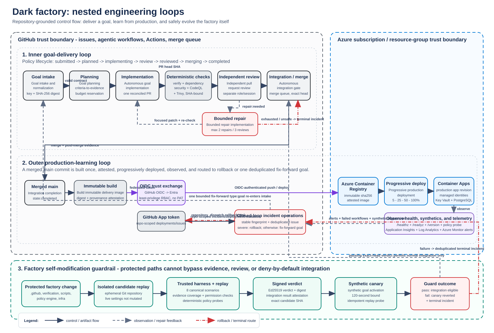

# Implemented architecture

## Architecture diagrams

The topology view shows the GitHub control plane, Azure runtime plane, trust
boundaries, identity flows, deployment path, observability, and incident
feedback loop.

The nested-loop view separates the fast inner engineering loop from the outer
production-learning loop and the protected self-modification loop.

Editable draw.io sources, diagram conventions, colors, and regeneration notes
are in [`docs/architecture/README.md`](architecture/README.md).

## End-to-end factory lifecycle

The normal entry point is a structured goal issue created from
`.github/ISSUE_TEMPLATE/goal.yml`. Goal submission is the authorization gate;
the factory does not introduce a later human approval step. Each workflow
revalidates the contract, current lifecycle label, digest, budgets, and
idempotency evidence before it mutates state.

|   # | Trigger point                                                                            | Step / workflow                                                               | What happens                                                                                                                                                                                                                                             | Success output / next state                                                                                                                        | Failure or feedback route                                                                                                                             |
| --: | ---------------------------------------------------------------------------------------- | ----------------------------------------------------------------------------- | -------------------------------------------------------------------------------------------------------------------------------------------------------------------------------------------------------------------------------------------------------- | -------------------------------------------------------------------------------------------------------------------------------------------------- | ----------------------------------------------------------------------------------------------------------------------------------------------------- |
|   1 | A goal issue is opened, edited, or reopened                                              | **Goal intake and normalization** (`goal-intake.md`)                          | Validates required fields and authorization, normalizes `goal_key`, computes the SHA-256 contract digest, detects duplicates or conflicts, classifies risk, and reconciles labels.                                                                       | Intake evidence is recorded; the goal remains `state:submitted` for planning.                                                                      | Invalid, unsafe, paused, conflicting, or injection-tainted goals become `state:terminal` and produce one deduplicated incident.                       |
|   2 | The intake evidence comment is created                                                   | **Goal planning** (`goal-planning.md`)                                        | Revalidates the contract, maps acceptance criteria to executable evidence, records permitted assumptions, reserves the strictest budget, and searches for an equivalent implementation.                                                                  | Plan evidence is recorded; `state:submitted` becomes `state:planned`.                                                                              | Unsafe uncertainty, exhausted budget, or an invalid plan routes to `state:terminal` and an incident.                                                  |
|   3 | The goal receives `state:planned`                                                        | **Autonomous goal implementation** (`coding-agent-assignment.md`)             | Reuses any equivalent PR, implements the narrowest reversible change, runs focused tests and policy validation, and accounts for files, lines, time, attempts, and runs.                                                                                 | The GitHub App safe-output boundary creates one `copilot/**` pull request; the goal becomes `state:implementing`.                                  | Unsafe, conflicting, unauthorized, empty, or exhausted work stops mutation and routes to `state:terminal`.                                            |
|   4 | The implementation PR is opened or updated                                               | **Deterministic verification** (`ci.yml`)                                     | Runs formatting, lint, type checks, tests, coverage, accessibility, build, policy, workflow, and evidence verification for the exact head SHA.                                                                                                           | Produces the SHA-bound `.evidence/manifest.json` and required verification check.                                                                  | A failing check blocks review approval and may become an actionable repair finding.                                                                   |
|   5 | The PR or head SHA changes                                                               | **Code security** and **Container and IaC security**                          | Runs dependency review, CodeQL, secret, filesystem, container, and IaC security checks without broad write permissions.                                                                                                                                  | Required security checks are attached to the exact PR head SHA.                                                                                    | Failed, skipped-required, neutral-required, stale, or pending checks cannot be treated as passing.                                                    |
|   6 | The PR changes or a required workflow completes                                          | **Independent pull request review** (`independent-pr-review.md`)              | A separate reviewer remaps every acceptance criterion to evidence; verifies digest, risk, assumptions, budgets, rollback, idempotency, required checks, and compatibility; and evaluates protected self-modification when applicable.                    | Approval reconciles the goal to `state:reviewed`; applicable `deployment:compatible` and `self-modification:safe` labels are added.                | Actionable findings set `state:review` plus `repair:needed`; unsafe risk, incompatibility, policy conflict, or exhaustion routes to `state:terminal`. |
|   7 | The goal is labeled `state:review` with `repair:needed`                                  | **Bounded repair implementation** (`bounded-repair-routing.md`)               | Reopens the one matching PR branch, applies only independent-review findings, reruns focused validation, and records the numbered repair operation key.                                                                                                  | One App-authenticated `push-to-pull-request-branch` returns the goal to `state:implementing`, which restarts checks and independent review.        | At most two repair attempts and three review cycles are allowed; conflict, unsafe work, or exhaustion sets `repair:exhausted` and `state:terminal`.   |
|   8 | Independent review completes successfully                                                | **Autonomous integration gate** (`autonomous-integration.yml`)                | Downloads evidence for the exact head, rechecks GitHub state, evaluates deny-by-default integration policy, and isolates/replays protected factory changes. A passing result is signed and attested.                                                     | Publishes `autonomous-integration/evidence`, adds `integration:ready`, admits the unchanged PR to the merge queue, and reconciles `state:merging`. | Stale evidence, changed head, failed criteria, incompatible deployment, unsafe self-modification, or a failed canary denies integration.              |
|   9 | GitHub requests merge-group checks                                                       | **Merge-group revalidation** (`autonomous-integration.yml`)                   | Revalidates every queued PR's exact-head check, lifecycle state, and integration label on the merge-group SHA.                                                                                                                                           | Publishes the required integration check on the merge group, allowing protected merge.                                                             | Any stale or invalid member blocks the merge group.                                                                                                   |
|  10 | The integration PR closes as merged                                                      | **Autonomous integration completion** (`autonomous-integration-complete.yml`) | Correlates the merged PR to its goal and verifies post-merge evidence.                                                                                                                                                                                   | `state:merging` becomes `state:completed`.                                                                                                         | Merge failure or changed policy routes the goal to `state:terminal`.                                                                                  |
|  11 | Deterministic verification succeeds on the pushed `main` SHA                             | **Build immutable delivery image** (`delivery.yml`)                           | Selects the exact verified commit, authenticates to Azure with GitHub OIDC, builds once, pushes to ACR by SHA, resolves the immutable digest, and creates build provenance.                                                                              | Calls the production workflow with an attested `@sha256` image reference.                                                                          | Build, registry, digest, OIDC, or attestation failure is admitted as an operational signal.                                                           |
|  12 | The delivery workflow calls production with an attested digest                           | **Progressive production deployment** (`production.yml`)                      | Verifies provenance and repository prefix, resolves the embedded commit, creates a GitHub deployment, creates an inactive Container Apps revision, optionally runs a retry-safe migration, and checks health, readiness, version, and policy synthetics. | Traffic advances through bounded canary stages (default `5,25,50,100`) and the deployment is marked successful.                                    | Any verification or observation failure restores the previous revision and records a failed deployment.                                               |
|  13 | Verified `main` changes infrastructure                                                   | **Trusted infrastructure deployment** (`infrastructure.yml`)                  | Reuses the exact verified SHA, compiles Bicep, records validation and what-if evidence, and deploys through the resource-group-scoped OIDC identity.                                                                                                     | Azure infrastructure matches the reviewed declarative state.                                                                                       | Validation, policy, or deployment failure emits evidence and enters incident correlation.                                                             |
|  14 | Azure alerts, failed workflows, scheduled synthetics, or manual sanitized signals arrive | **Closed-loop production incident operations** (`incident-operations.yml`)    | Correlates commit, revision, deployment, workflow, trace, and fingerprint data; suppresses duplicate signal storms; and creates or updates one canonical incident.                                                                                       | Lower-severity fix-forward work creates one stricter-budget goal that re-enters step 1.                                                            | Active Sev0/Sev1 regressions dispatch rollback before diagnosis; unsafe or exhausted work remains terminal.                                           |
|  15 | Rollback is dispatched or manually requested with a known revision                       | **Production traffic rollback** (`rollback.yml`)                              | Authenticates through OIDC, restores the named or previous healthy Container Apps revision, verifies it, and records a GitHub deployment result.                                                                                                         | Service returns to a verified revision while the incident remains correlated for diagnosis.                                                        | Rollback failure remains a high-severity incident and does not authorize unbounded retries.                                                           |
|  16 | Any goal enters `state:terminal`                                                         | **Terminal incident reconciliation** (`terminal-incident.md`)                 | Stops all repository mutation, normalizes the failure key, and creates or updates one incident with sanitized evidence, attempts, budget consumption, and recovery status.                                                                               | The goal stays terminal and the incident is `state:reported`; no further coding assignment occurs.                                                 | Incident-recording failure is surfaced in workflow output without attempting unrelated mutation.                                                      |

## Runtime

The Node.js API serves the built React control room and exposes health,
readiness, version, policy, and factory operations contracts. The React surface
uses only those contracts; it does not infer state from GitHub or Azure.

`FactoryOperationsAdapter` is the production boundary. The default
`DemoFactoryOperationsAdapter` provides deterministic local records and derives
throughput, lead time, autonomous completion, retries, repairs, rollback rate,
escaped defects, MTTR, and estimated agent/runtime costs. Production mode fails
closed until an adapter is supplied instead of silently showing demo data.

## Decision lineage

Policy responses, goals, incidents, deployments, and audit events carry the
same required correlation envelope:

- goal ID and pull request
- commit SHA and workflow run ID
- deployment ID and runtime revision
- trace ID and correlation ID
- final policy verdict

The policy endpoint rejects incomplete envelopes and replaces the caller's
pending verdict with the evaluated result. This makes a decision traceable from
goal intake through merge, deployment, rollback, and incident handling.

## Control and delivery planes

GitHub Actions is the control plane. Agentic workflows intake and plan goals;
conventional workflows verify, integrate, deliver immutable images, progressively
shift traffic, and roll back. Azure Container Apps is the runtime plane.
Repository reconciliation and Azure deployment are intentionally separate,
explicit live activation steps. Local verification never changes either plane.

## Azure alert bridge

Azure Monitor sends common-alert-schema events to a function-authenticated
Azure Functions Flex Consumption endpoint. The alert adapter normalizes
severity, rule and correlation identifiers, commit SHA, and Container Apps
revision; claims a managed-identity-authenticated Table Storage key to suppress
retries; and sends the existing incident workflow a repository dispatch.

The adapter retrieves the Dark Factory Mage private key from private Key Vault
through its dedicated managed identity. It mints an installation token only for
App `5122991` installation `168176539` and never persists that token or a PAT.
The application and worker Container Apps remain independently deployed and
unchanged by this bridge.

## Failure behavior

Configuration is validated before the API listens. Missing production data
integration returns `503`. Policies deny by default. Delivery uses bounded
canaries and immutable digests. Incident fingerprints and correlation IDs make
retries idempotent. Teardown tooling emits a plan only and refuses `--apply`.
